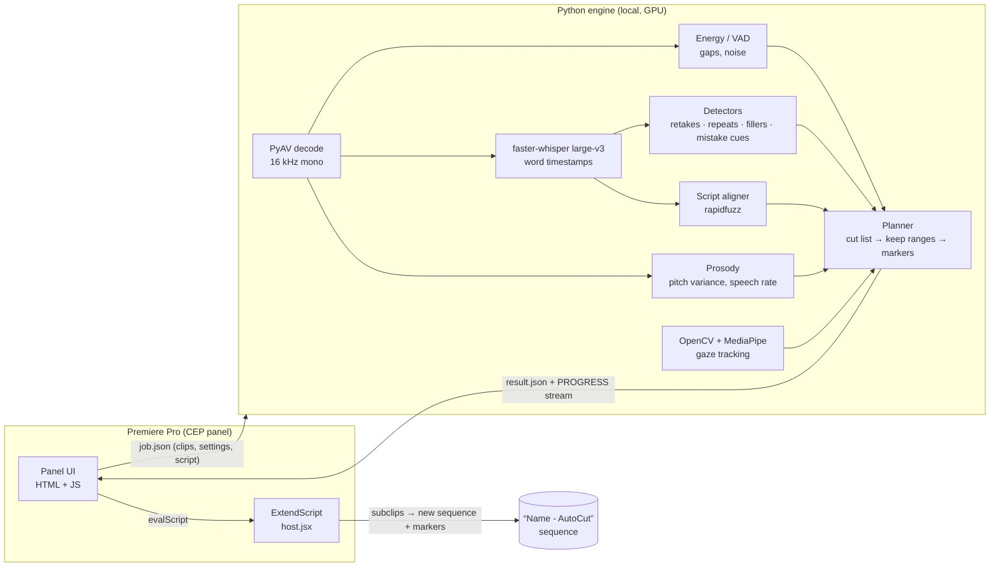

<div align="center">

# ✂️ AutoCut for Premiere Pro

**An AI editing assistant that turns a raw talking-head recording into a clean first cut, in one click.**

It removes silences, retakes, "افف نسيت الكلام" moments, filler sounds and the parts where you read from your notes.
Built for **Egyptian Arabic** creators, and works in English too.

[](https://github.com/ramisalahhh/premiere-autocut/actions/workflows/ci.yml)


</div>

---

## The problem

Recording a short-form video usually means saying each line three or four times without stopping the camera. Before editing can start, someone has to:

- scrub through every silence and false start,
- find the **last good take** of each sentence,
- cut the "معلش", "خليني أعيد", "اتلخبطت" moments,
- and spot the parts where you were obviously reading from the script.

On a 5-minute recording that is easily 20–30 minutes of tedious work.

## What AutoCut does

| Problem | How it's detected | Default action |
|---|---|---|
| **Silences / dead air** | Adaptive audio-energy threshold (learns your room's noise floor) | Cut, keeps breathing room |
| **Retakes** (restarting a line without stopping the camera) | Word-level transcript + fuzzy matching of repeated phrases → **keeps the last take** | Cut |
| **Restart mid-sentence** | End of one phrase repeated at the start of the next | Cut only the broken tail |
| **Quick repeats** ("انا النهارده انا النهارده") | Back-to-back repeated n-grams | Cut |
| **Mistake talk** ("افف انا نسيت الكلام", "ستوب", "خليني أعيد") | Curated Egyptian-Arabic cue list (strong vs. weak cues) | Strong → cut, weak → review marker |
| **Fillers** (امم، اااه، افف) | Pattern matching ("آه" meaning *yes* is kept) | Cut |
| **Reading the script** | MediaPipe face/iris tracking (looking down/away) **+** flat, slow voice compared with your own baseline | Both signals → cut, one → review marker |
| **Coughs, bumps, background talk** | Sound energy with no recognized words | Review marker |

### 📝 Script-guided mode
Paste the script you were following. AutoCut finds each spoken phrase in it with fuzzy alignment, so **changed, skipped or extra words still match**. Then:
- going *back* in the script means a retake, so only the last attempt is kept;
- parts that aren't in the script (your ad-libs) are **marked, never silently deleted**. A long paraphrase still scores 60–100% on word coverage, so real content is protected.

### 🛟 Non-destructive by design
Your original sequence is never touched. AutoCut builds a **new sequence from subclips**. Everything it isn't sure about gets an `AC: CHECK …` marker, and a clickable **transcript view** shows every phrase it heard, colored kept / cut / check, with the reason.

## How it works



- **Panel ↔ engine:** the CEP panel spawns `engine/analyze.py` with Node's `child_process`. The engine streams `PROGRESS` / `LOG` lines on stdout and writes `result.json`.
- **Caching:** transcripts and gaze tracks are cached per media file (keyed by path, size, mtime and range), so re-running with different settings is **instant**.
- **Everything runs locally.** No upload, no API keys.

More detail: [`docs/ARCHITECTURE.md`](docs/ARCHITECTURE.md) · Tuning guide: [`docs/TUNING.md`](docs/TUNING.md)

## Install (Windows)

**Requirements:** Premiere Pro 2022+ · Python 3.10–3.14 ("Add to PATH" ticked) · NVIDIA GPU recommended (it falls back to CPU)

```bat
git clone https://github.com/ramisalahhh/premiere-autocut.git
cd premiere-autocut
install.bat
```

`install.bat`:
1. enables unsigned CEP panels (`PlayerDebugMode`),
2. copies the extension to `%APPDATA%\Adobe\CEP\extensions\AutoCut`,
3. creates an isolated virtual env (`engine\.venv`) and installs the engine,
4. downloads Whisper large-v3 (~3 GB, once) and the face-landmark model (~4 MB),
5. runs a health check (`check_setup.py`).

Then open Premiere → **Window → Extensions → AutoCut**.

## Usage

1. Put your talking-head clips on **V1** and open the sequence.
2. *(Optional)* paste your script into the **Script** box.
3. Click **Preview as markers** to see what will be cut and why, right on your timeline.
4. Click **Analyze & build cut sequence**.
5. Review the orange `AC: CHECK` markers (**Shift+M** jumps between them) or click lines in the transcript view.

## Development

```bash
pip install -r requirements-dev.txt   # light deps, no GPU needed
pytest -q                             # 45 tests: detectors, script mode, planner, gaze, prosody, CLI
ruff check engine tests
```

The test-suite uses synthetic Arabic transcripts and generated audio, so it runs anywhere in a couple of seconds. CI runs it on Python 3.10, 3.12 and 3.14, and also checks the panel's JS, ExtendScript and manifest.

```
premiere-autocut/
├── CSXS/manifest.xml        CEP manifest (PPRO 22+)
├── index.html  css/  js/    panel UI + engine runner (Node)
├── jsx/host.jsx             ExtendScript: read V1, subclips, new sequence, markers, seek
├── engine/
│   ├── analyze.py           entry point: decode → transcribe → detect → plan
│   ├── detectors.py         gaps, noise, retakes, repeats, fillers, mistake cues
│   ├── script_align.py      fuzzy script alignment + off-script scoring
│   ├── vision.py            MediaPipe gaze / head-pose tracking
│   ├── prosody.py           flat-voice detection
│   ├── plan.py              cut list → keep ranges, markers, transcript view
│   └── setup_engine.bat · check_setup.py · requirements.txt
├── tests/                   pytest suite
└── docs/                    architecture & tuning
```

## Roadmap

- [ ] Recover quiet speech that the VAD drops (second pass with no VAD on long "silent" stretches)
- [ ] Multi-track support (separate mic on A1)
- [ ] Carry effects/color from the source clips into the cut sequence
- [ ] UXP version for Premiere 2025+
- [ ] Learn from the user's manual fixes (per-creator cue lists)

## Built with

[faster-whisper](https://github.com/SYSTRAN/faster-whisper) · [CTranslate2](https://github.com/OpenNMT/CTranslate2) · [MediaPipe](https://github.com/google-ai-edge/mediapipe) · [OpenCV](https://opencv.org) · [librosa](https://librosa.org) · [rapidfuzz](https://github.com/rapidfuzz/RapidFuzz) · [PyAV](https://github.com/PyAV-Org/PyAV) · Adobe CEP / ExtendScript

## License

MIT © Rami Mohamed Salah
