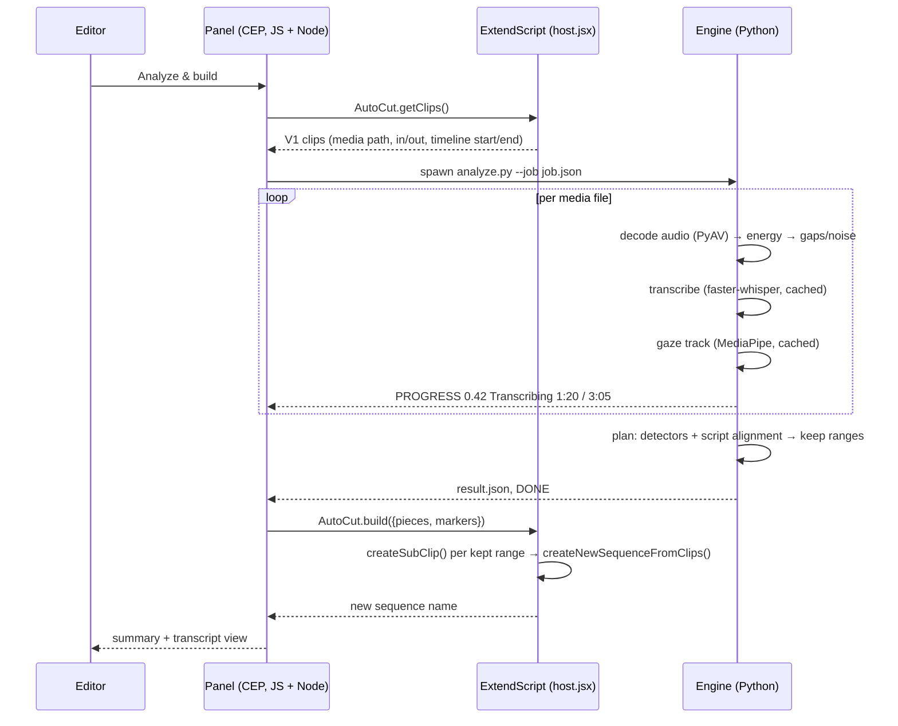

# Architecture

## Components

## Engine pipeline

1. **Decode**: `analyze.decode_range()` uses PyAV to read only the used range of each file, resampled to 16 kHz mono float32.
2. **Energy / VAD**: 20 ms RMS frames in dBFS. The threshold is `min(p10 + margin, p95 − 12 dB)`, so it adapts to the room. Small holes are filled and clicks removed. This gives:
   - **gaps**: silent runs ≥ `min_gap`, shrunk by `pad` on each side;
   - **noise**: active runs with no recognized words.
3. **Transcription**: faster-whisper large-v3, `word_timestamps=True`, Silero VAD, `condition_on_previous_text=False` (prevents repetition loops), and an Egyptian-Arabic initial prompt. Low-confidence words over silence are dropped as hallucinations.
4. **Phrasing**: words are split into phrases at pauses > 0.3 s or at sentence punctuation.
5. **Detectors**:
   - *Retakes*: phrase P is re-said at the start of a later phrase Q (rapidfuzz ratio ≥ 80) → cut P…Q. If only the end of P is re-said, only that tail is cut.
   - *Stutters*: an immediately repeated 2–6-gram with no pause.
   - *Fillers*: a regex on normalized tokens.
   - *Mistake cues*: strong cues → cut (whole phrase if the cue is in the first 6 words, otherwise from the cue on); weak cues → review.
6. **Script mode** (`script_align.py`):
   - Each phrase is located in the script with `partial_ratio_alignment`, searching from ~150 words behind the last confident hit. This handles going back for retakes and repeated lines in the script.
   - A stack of kept phrases is maintained in script order. A new phrase whose script position is ≤ the top of the stack pops it as a retake. A partial overlap cuts the tail of the previous phrase.
   - **Off-script score** = `max(sequence match, word coverage)`. Word coverage is the share of the phrase's words found fuzzily in the script vocabulary; it is robust to paraphrasing.
7. **Reading detection**:
   - *Gaze*: per-frame features (head pitch, eye openness, iris vertical position, yaw). Robust z-scores against the clip's own median/MAD, plus a majority filter to drop blinks.
   - *Prosody*: per-phrase pitch std (semitones, YIN) and words per second, z-scored against the same clip.
   - Both signals → `reading` (cut in auto mode); one signal → review.
8. **Plan**: merge cuts → subtract from each clip's source range → drop slivers < `min_keep` → pieces with `new_start` on the output timeline. Review markers are mapped onto the new timeline; preview markers onto the original.

## Why subclips?
Razor/ripple editing through ExtendScript is fragile across Premiere versions and destroys the original. `ProjectItem.createSubClip()` + `Project.createNewSequenceFromClips()` are stable since 2017, keep linked audio, and leave the source sequence untouched.

## Performance
| Step | ~10 min of 1080p footage, RTX 3060 |
|---|---|
| Whisper large-v3 (fp16) | 60–120 s, first run only (cached) |
| Gaze tracking @ 5 fps | 40–60 s, first run only (cached) |
| Detection + planning | < 1 s |
| Building the sequence | 2–5 s |
